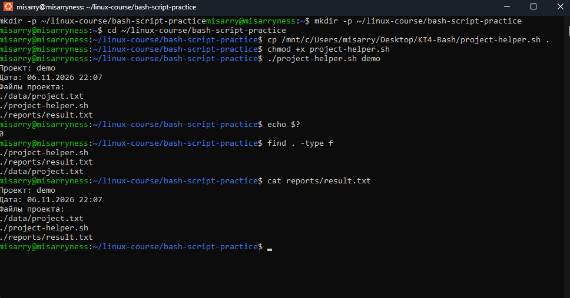

# КТ №4. Основы Bash-скриптов

Скрипт принимает имя проекта, создаёт папки `data`, `reports` и `output` и сохраняет результат в `reports/result.txt`.

```bash
chmod +x project-helper.sh
./project-helper.sh demo
echo $?
find . -type f
cat reports/result.txt
```

Без имени проекта скрипт выведет подсказку и завершится с кодом 1. Успешный запуск возвращает 0. `if` проверяет аргумент, `for` создаёт папки, а функции разделяют создание структуры и запись результата. `>` начинает отчёт заново, `>>` дописывает строки.

## Скриншот запуска


